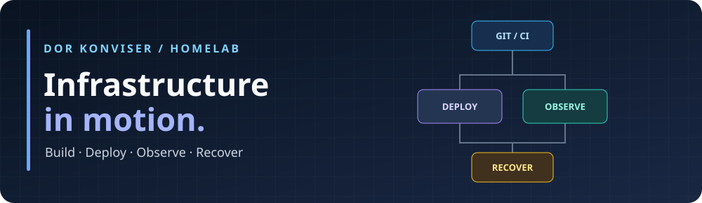
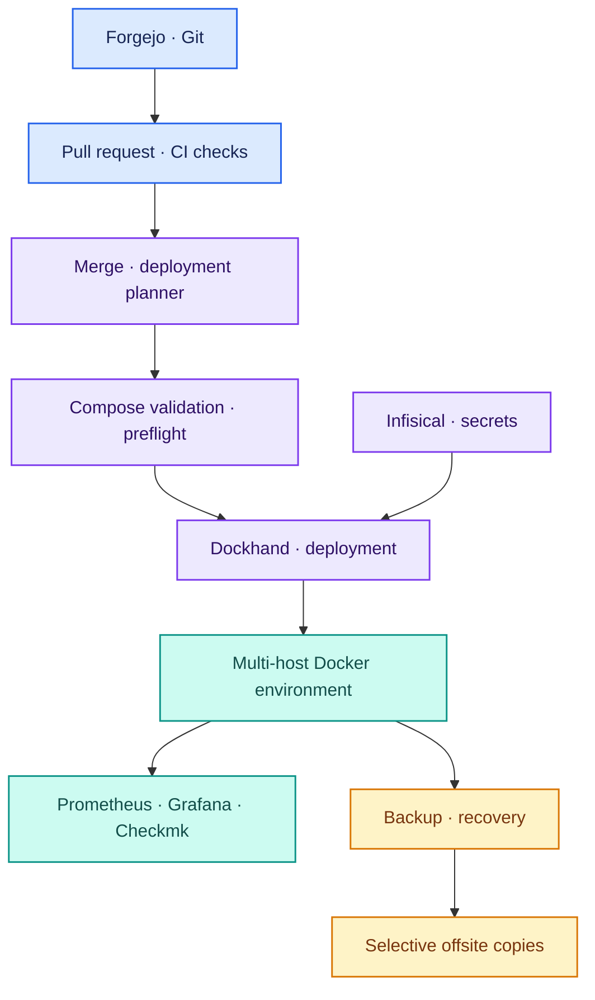
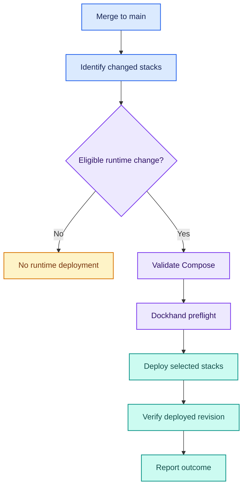
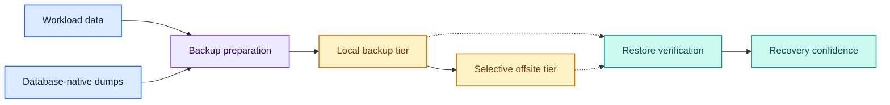

# My Homelab Infrastructure

<strong>From a Git commit to a running service — and everything in between.</strong>

  
  
  

  <a href="architecture/overview.md">Architecture</a> ·
  <a href="ci-cd/deployment-workflow.md">Deployments</a> ·
  <a href="reliability/disaster-recovery.md">Recovery</a> ·
  <a href="case-studies/deployment-migration.md">Case study</a>

I started building this environment to run my own services. Over time, the interesting part became managing changes across multiple machines without turning every upgrade into a manual maintenance task.

My professional background is in Tier 3 support and production troubleshooting. This homelab is where I independently explore infrastructure engineering, DevOps practices and automation.

The numbers above describe the documented repository snapshot, not a live inventory of running services.

## The tools behind the lab

| Source & deployment | Monitoring | Security & recovery |
| --- | --- | --- |
|  |  |  |
|  |  |  |
|  |  |  |
|  |  |  |

## 01 · How everything fits together

*Logical architecture, not a physical network map.*

| Area | Tools and responsibilities |
| --- | --- |
| Version control | Forgejo, Git, pull requests |
| Deployment | CI/CD, central policy, Docker Compose, Dockhand |
| Secrets | Infisical, separation of configuration and credentials |
| Observability | Prometheus, Grafana, Checkmk |
| Recovery | Restic, Borg, selective offsite backups |

## 02 · How a change reaches the hosts

The manifest determines which changed stacks are eligible for deployment. Dependencies define ordering, not application health. A deployed revision confirms the configuration version, not the health of every service.

[Explore the deployment workflow →](ci-cd/deployment-workflow.md) · [See the 11 quality gates →](ci-cd/quality-gates.md)

## 03 · Designing for recovery

*The dashed paths represent verification activities, not a claim that every restore has been tested.*

I treat a successful backup and a proven restore as different things. Offsite coverage is selective, and recovery confidence depends on verification.

[Read about disaster recovery →](reliability/disaster-recovery.md)

## 04 · Engineering decisions worth documenting

| Topic | Why it matters |
| --- | --- |
| [Architecture and host roles](architecture/overview.md) | Understanding where responsibilities belong |
| [Changing the deployment engine](case-studies/deployment-migration.md) | Separating policy from execution and recognizing an untested fallback |
| [Observability](reliability/observability.md) | Detecting failures, including missing scheduled activity |
| [Secrets management](security/secrets-management.md) | Keeping credentials out of versioned configuration |
| [Synthetic examples](examples/README.md) | Exploring Compose and deployment policy without exposing live configuration |

## What's next?

I'm working toward stronger recovery confidence and easier-to-verify infrastructure changes. One known gap is the untested return path to the former deployment engine. Keeping an older tool available is not the same as proving recovery.

> This is a public engineering portfolio, not a mirror of my private homelab. Network details, private identifiers, credentials, live configurations and operational paths are deliberately omitted. Examples are synthetic.

[Back to my GitHub profile](https://github.com/dorko87)
