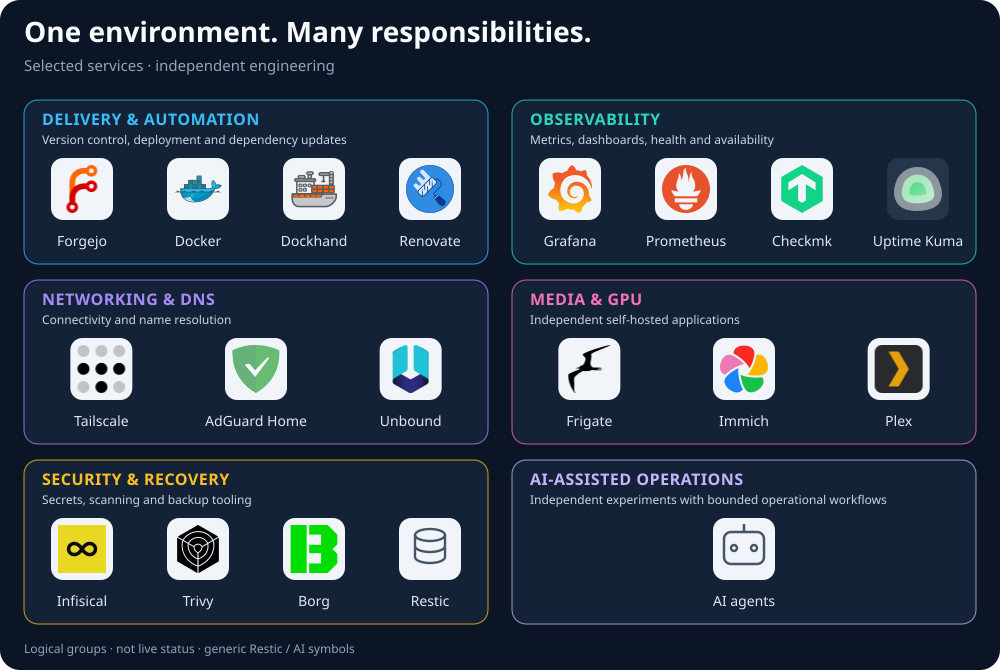
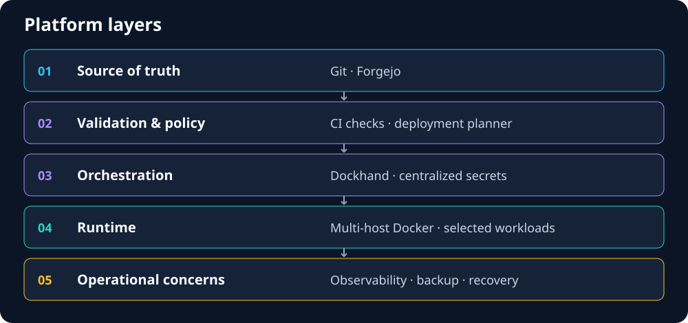
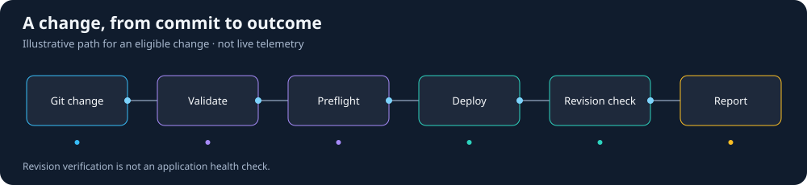
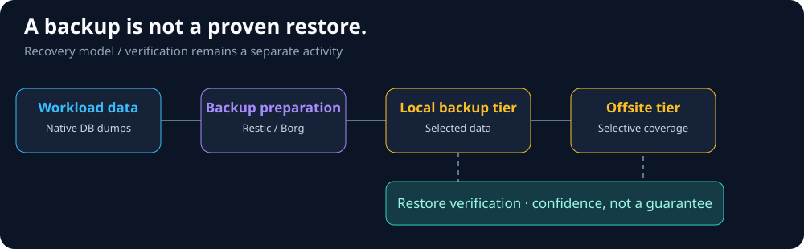

# My Homelab Infrastructure

<strong>From a Git commit to a running service — and everything in between.</strong>

  
  
  

  <a href="architecture/overview.md">Architecture</a> ·
  <a href="ci-cd/deployment-workflow.md">Deployments</a> ·
  <a href="reliability/disaster-recovery.md">Recovery</a> ·
  <a href="case-studies/deployment-migration.md">Case study</a>

I started building this environment to run my own services. Over time, the interesting part became managing changes across multiple machines without turning every upgrade into a manual maintenance task.

My professional background is in Tier 3 support and production troubleshooting. This homelab is where I independently explore infrastructure engineering, DevOps practices and automation.

The numbers above describe the private configuration snapshot dated November 24, 2026, not a live inventory of running services. The public portfolio has its own independent validation workflow.

## The service ecosystem

<picture>
  <source media="(max-width: 600px)" srcset="assets/service-ecosystem-mobile.svg">
  
</picture>

[Compact mobile layout](assets/service-ecosystem-mobile.svg) · [Full-size ecosystem](assets/service-ecosystem.svg)

A selected view of the tools and applications I use, grouped by responsibility rather than physical location. I also explore AI-assisted operational workflows as independent experiments. This is not a complete or live service inventory.

Accessible text version of the ecosystem

- Delivery: Forgejo, Docker, Dockhand, Renovate
- Observability: Grafana, Prometheus, Checkmk, Uptime Kuma
- Networking: Tailscale, AdGuard Home, Unbound
- Media: Frigate, Immich, Plex
- Security and recovery: Infisical, Trivy, Borg, Restic
- Automation: AI-assisted operational experiments

[Logo sources and attribution](assets/README.md)

## 01 · How everything fits together

[Detailed architecture and host roles](architecture/overview.md)

*Logical architecture, not a physical network map.*

## 02 · How a change reaches the hosts

*Conceptual animation, not live status. One 4.8-second cycle; reduced-motion preferences disable the animation. The detailed decision flow is in the deployment documentation.*

The manifest determines which changed stacks are eligible for deployment. Documentation-only changes and excluded stacks do not deploy. Independent stack failures are reported without treating revision verification as an application health check. Dependencies define ordering, not application health. A deployed revision confirms the configuration version, not the health of every service.

[Explore the deployment workflow →](ci-cd/deployment-workflow.md) · [See the 11 quality gates →](ci-cd/quality-gates.md)

## 03 · Designing for recovery

*Restore verification is a separate activity, not a claim that every restore has been tested.*

I treat a successful backup and a proven restore as different things. Offsite coverage is selective, and recovery confidence depends on verification.

[Read about disaster recovery →](reliability/disaster-recovery.md)

## 04 · Engineering decisions worth documenting

| Topic | Why it matters |
| --- | --- |
| [Architecture and host roles](architecture/overview.md) | Understanding where responsibilities belong |
| [Changing the deployment engine](case-studies/deployment-migration.md) | Separating policy from execution and recognizing an untested fallback |
| [Observability](reliability/observability.md) | Detecting failures, including missing scheduled activity |
| [Secrets management](security/secrets-management.md) | Keeping credentials out of versioned configuration |
| [Synthetic examples](examples/README.md) | Exploring Compose and deployment policy without exposing live configuration |

## What's next?

I'm working toward stronger recovery confidence and easier-to-verify infrastructure changes. One known gap is the untested return path to the former deployment engine. Keeping an older tool available is not the same as proving recovery.

> This is a public engineering portfolio, not a mirror of my private homelab. Network details, private identifiers, credentials, live configurations and operational paths are deliberately omitted. Examples are synthetic.

[Back to my GitHub profile](https://github.com/dorko87)
