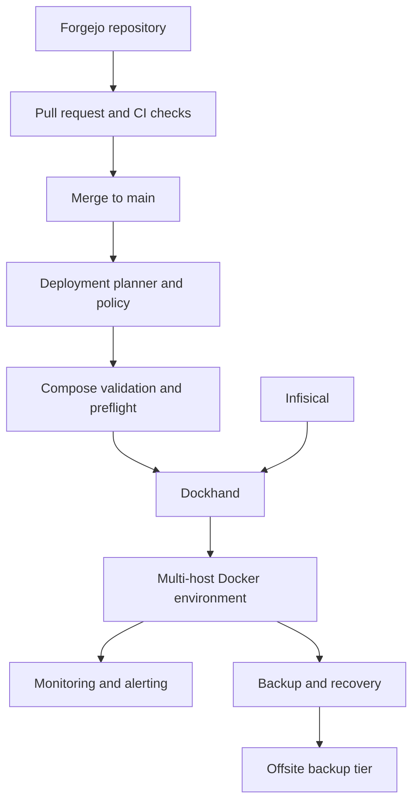

# My homelab infrastructure

**Self-hosting, infrastructure automation and reliability**

I started building this environment to run my own services. Over time, the interesting part became managing changes across multiple machines without turning every upgrade into a manual maintenance task.

This repository is a public engineering portfolio based on my private homelab. It documents the architecture, decisions and operational practices rather than mirroring my live configuration. My professional background is in Tier 3 support and production troubleshooting; the infrastructure work described here is independent, hands-on experience.

| Scope | Repository snapshot |
| --- | --- |
| Infrastructure | 5 defined hosts, including an offsite role |
| Container workloads | 39 defined stacks (not necessarily all running) |
| Continuous integration | 11 validation jobs |
| Deployment | Git-managed configuration, Dockhand orchestration |

## How it fits together

## Engineering notes

| Area | What I document |
| --- | --- |
| [Architecture](architecture/overview.md) | How the components fit together |
| [Deployment workflow](ci-cd/deployment-workflow.md) | Change detection, policy, validation and revision checks |
| [Quality gates](ci-cd/quality-gates.md) | What gets checked before changes are merged |
| [Deployment migration](case-studies/deployment-migration.md) | Moving from Komodo to Dockhand and the remaining fallback gap |
| [Observability](reliability/observability.md) | Monitoring and detecting silent failures |
| [Disaster recovery](reliability/disaster-recovery.md) | Backup priorities and restore confidence |
| [Secrets management](security/secrets-management.md) | Separating credentials from configuration |
| [Examples](examples/README.md) | Small, synthetic configuration examples |

## What I am still working on

I want to keep improving recovery confidence and make operational changes easier to understand and verify. One specific gap is the untested recovery path from Dockhand to the former deployment engine. Retaining the former tool is not the same thing as a demonstrated recovery path.

The diagrams are logical views. Real network details, credentials, service inventories, private paths and operational identifiers are deliberately omitted. Examples are illustrative and are not the live configuration.

[GitHub profile](https://github.com/dorko87)
