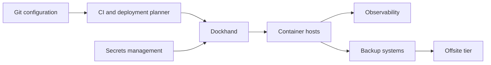

# Architecture overview

The environment is organized around five defined host roles, with container workloads distributed according to their resource and recovery needs. Git is the source of truth for stack definitions. Forgejo runs validation and deployment workflows; Dockhand is the active deployment engine. Infisical provides centralized secrets management. Monitoring and backup systems are separate operational concerns rather than implicit properties of the deployment pipeline.

The host roles include general application workloads, GPU workloads, backup, additional compute and offsite recovery. A defined host or stack is not necessarily online. The diagram intentionally omits physical topology and access details.

## Design choices

- Keep deployment policy separate from the executor and from documentation policy.
- Use versioned container definitions, rather than relying on moving image tags.
- Keep operational documentation and configuration changes in the same review process.
- Treat deployment success, application health and recoverability as distinct checks.
