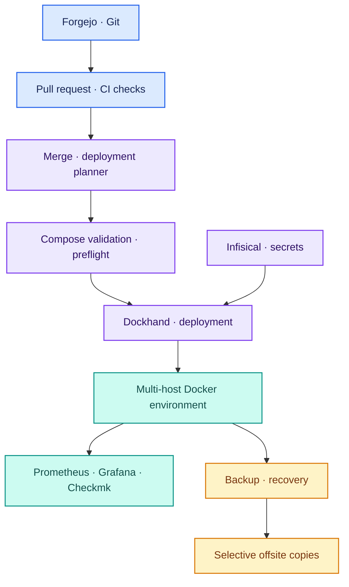
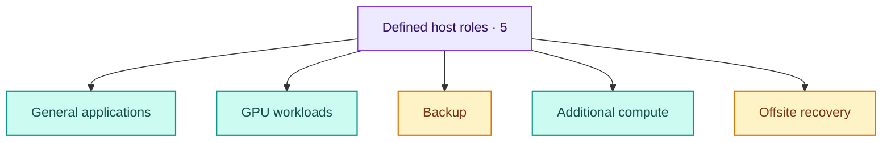

# Architecture overview

I organize the homelab around five host roles. Workloads are placed according to their resource and recovery needs. Git holds the stack definitions, Forgejo runs the CI workflows, and Dockhand deploys the selected stacks. I use Infisical for secrets. Monitoring and backups run separately from the deployment workflow.

The host roles include general application workloads, GPU workloads, backup, additional compute and offsite recovery. A defined host or stack is not necessarily online. The diagram intentionally omits physical topology and access details.

## Design choices

- Keep deployment policy separate from the executor and from documentation policy.
- Use versioned container definitions, rather than relying on moving image tags.
- Keep operational documentation and configuration changes in the same review process.
- Treat deployment success, application health and recoverability as distinct checks.

## Defined host roles

*Logical responsibilities; not a live inventory.*
