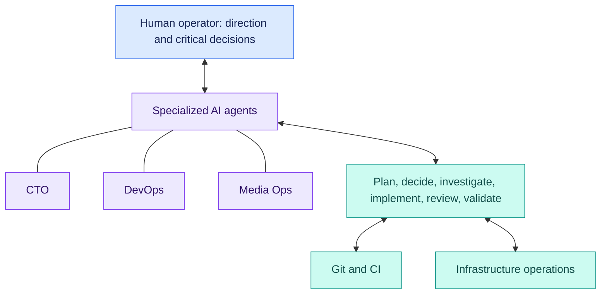

# Working with AI agents

I use specialized AI agents to help manage my homelab. Each agent has its own area of responsibility and can work independently, make technical decisions, investigate issues, implement changes, review work and validate results.

The agents can collaborate across different areas of the infrastructure. I set the overall direction and remain responsible for critical decisions.

## Areas of responsibility

| Agent | Focus |
| --- | --- |
| CTO | Architecture and technical design |
| DevOps | Infrastructure and automation |
| Media Ops | Application operations |

These are logical roles, not a description of live access permissions.

## How the work fits together

The agents can take a task from investigation through planning, implementation and review. Git and CI provide a way to track and check configuration changes. The same engineering checks still matter when a change is proposed by an agent.

This diagram shows the operating model, not actual connections or permission rules. Agent capabilities do not mean every proposed change is correct. Review and validation remain important.

See [deployment workflow](../ci-cd/deployment-workflow.md) for the separate deployment process.
