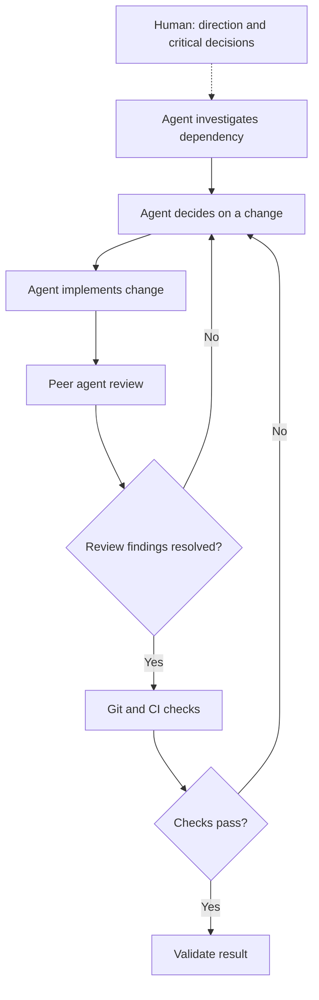

# Working with specialized AI agents

I use agents with different areas of responsibility in the homelab. They can investigate problems, make technical decisions, implement changes, review work and validate results. I set the overall direction and make critical decisions.

The challenge is keeping the agents' work consistent with the configuration in Git and with each other's responsibilities.

## Example workflow

Consider a proposed change to a shared application dependency. This is an illustrative scenario, not a recorded incident.

An agent could investigate the dependency, check the affected configuration and propose a change. Another agent could review the change from an infrastructure or application perspective. The agents can make decisions and revise their work based on that review.

The agents can decide how to investigate and implement the change, and can review each other's work without requiring routine human approval. I remain responsible for critical decisions.

This is one possible collaboration pattern, not a mandatory approval chain. The resulting change can be checked against the same Git and CI workflow used for other configuration changes. Passing CI does not replace application health checks.

This example explains how the roles can work together. It does not claim that every change follows this exact sequence or that agent decisions are always correct.

See [working with AI agents](../automation/ai-assisted-operations.md) for the operating model.
