# Changing the deployment engine

## The problem

I wanted a more maintainable deployment workflow without coupling the entire repository to a single orchestration tool.

## The approach

The migration from Komodo to Dockhand separates policy from execution. Git defines the desired configuration, a manifest determines what can deploy, and the planner identifies changed stacks before validation and preflight. Dockhand handles deployment and the workflow checks the deployed revision.

## Current state

The source snapshot documents Dockhand as the active executor. Komodo is retained but inactive; its former executor and runtime switch were removed from the pipeline. Returning to the former mechanism would require a deliberate change, not an automatic switch.

## Remaining gap

The runbook explicitly records that the fallback drill was not performed. I therefore treat fallback as unproven. The key lesson is that retaining a tool is not equivalent to testing recovery. Canary validation is useful for changes to the active deployment engine, but does not establish fallback readiness.

## Visual overview

```mermaid
flowchart LR
    A["Earlier · Komodo"] --> B["Separate policy from execution"]
    B --> C["Current · Dockhand"]
    C -.-> D["Former engine retained"]
    D -.-> E["Fallback drill not performed"]
    class A source;
    class B control;
    class C runtime;
    class D recovery;
    class E caution;
    classDef source fill:#DBEAFE,stroke:#2563EB,color:#172554,stroke-width:1.5px;
    classDef control fill:#EDE9FE,stroke:#7C3AED,color:#2E1065,stroke-width:1.5px;
    classDef runtime fill:#CCFBF1,stroke:#0D9488,color:#134E4A,stroke-width:1.5px;
    classDef recovery fill:#FEF3C7,stroke:#D97706,color:#78350F,stroke-width:1.5px;
    classDef caution fill:#FEE2E2,stroke:#DC2626,color:#7F1D1D,stroke-width:1.5px;
```

