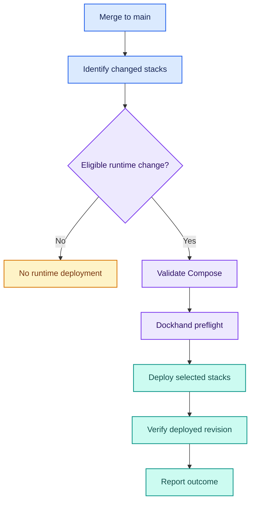

# From merge to deployment

A merge to the main branch triggers a workflow that identifies changed runtime stacks. The central deployment manifest determines which stacks may deploy and their order. Documentation-only changes and excluded stacks do not trigger runtime deployment.

The workflow delegates planning and validation to scripts, and Dockhand performs the deployment. The manifest classifies every stack as deployable or excluded. Dependencies are ordering constraints when both stacks change; they are not health gates. A failure in one independent stack does not stop all other attempts, but the overall job reports failure. A missing Compose definition for a selected stack fails closed.

The deployed revision is checked against the merge revision. This confirms which configuration was deployed, not whether every application is healthy. Generated documentation is published after successful deployment. The public example manifest is intentionally simplified.
