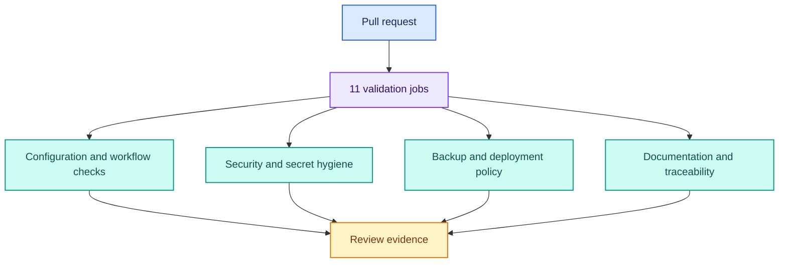

# Quality gates

The source snapshot defines eleven CI jobs covering these checks:

| Check | Purpose |
| --- | --- |
| Compose validation | Catch invalid container definitions |
| Workflow static analysis | Check workflow structure |
| Renovate validation | Check dependency-update configuration |
| Backup guards | Protect backup-related configuration |
| Trivy scanning | Identify security findings |
| Documentation checks | Keep required documentation present |
| Stack checks | Enforce stack conventions |
| New-stack completeness | Require supporting configuration and documentation |
| Deployment policy | Ensure every stack is classified |
| Secret hygiene | Detect inappropriate credential handling |
| Ticket reference | Support change traceability |

Branch protection and pull-request checks are documented in the private repository. Image updates are managed through Renovate, with review rules and exclusions. These checks catch some problems before deployment. I still need to check application health and plan for recovery.

## Visual overview

