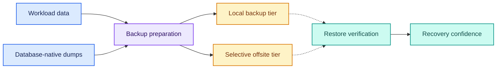

# Backup and disaster recovery

The repository maintains a backup inventory organized by priority and recovery requirements. It distinguishes database backups, configuration and credential-related data, and the offsite backup tier. Restic and Borg are among the tools used.

A copy on the same storage failure domain is not an independent backup. For databases, copying live volume files may leave an inconsistent backup. The documented approach includes database-native dumps.

The inventory explicitly distinguishes covered, deferred and externally managed targets. Offsite coverage is selective, not universal. Backup job success is not proof that restoration works. Restore drills and verification of backup freshness are important parts of recovery confidence.

No recovery commands, storage paths, retention policies, schedules or target identifiers are published here.

## Visual overview

*Dashed arrows indicate verification activities, not completed restore tests.*
