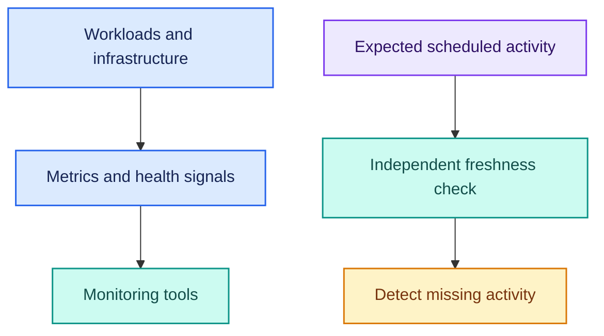

# Observability

The homelab uses monitoring components including Prometheus, Grafana and Checkmk. I use monitoring to understand infrastructure and service behavior rather than assuming a successful deployment means everything is healthy.

An operational lesson documented in the repository is that a scheduled task cannot reliably detect its own absence. Monitoring for silence requires an independent check of whether expected activity occurred. This matters for dependency updates, backups and other recurring operations.

The public portfolio does not reproduce live dashboards, alert destinations, monitoring targets or operational thresholds.

## Visual overview

