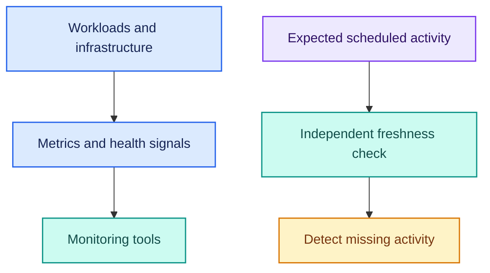

# Observability

I use Prometheus, Grafana and Checkmk to monitor infrastructure and services. A successful deployment does not tell me whether the application is healthy.

A scheduled task cannot report an error if it never starts. A separate check needs to look for missing activity. This matters for dependency updates, backups and other recurring operations.

See [detecting silent failures](../case-studies/detecting-silent-failures.md) for an example investigation. Live dashboards and monitoring details are not included here.

## Visual overview

