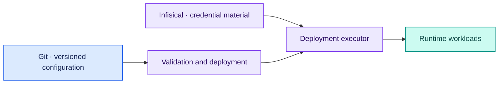

# Secrets management

Configuration and credentials are handled separately. The private environment uses Infisical and repository-level secret hygiene checks, with deployment credentials scoped to the deployment workflow. The deployment runbook documents precautions against printing sensitive API responses.

For this public portfolio, all configuration examples are written from scratch. No private environment files, secret references, authentication settings, internal endpoints or live access policies are included. This is a documentation overview, not a disclosure of the security topology or a security audit of the live system.

## Visual overview

